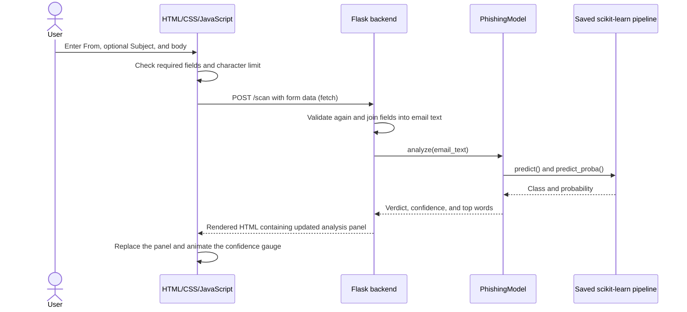

# Phishing Detector: beginner-friendly code guide

This guide explains how the Phishing Detector is built and how an email moves through it. It is written for someone who is new to web pages, Python, Flask, and machine learning.

The project has four main parts:

1. **Frontend:** the page the user sees and interacts with.
2. **Backend:** the Flask/Python code that receives the form and asks the model for a result.
3. **Connection:** how the browser, Flask, and the saved model pass information to one another.
4. **Accounts and saved scans:** Supabase Auth handles logins, and Supabase Postgres stores scan inputs and results under row-level access rules.

The website loads its classifier from `models/email_classifier.pkl`. A scan sends email text to that saved model for a prediction; it does not modify the model file. The backend also saves each completed scan in Supabase so an admin can review it. The final section, **Supabase accounts and saved scan dataset**, explains that newer part and its setup.

## 1. Frontend: the page and the interactions

The frontend is made from HTML, CSS, JavaScript, and Jinja2 template expressions. The HTML describes the page parts, the CSS controls their appearance, JavaScript responds to clicks and typing, and Jinja2 inserts values sent by Flask.

### Frontend files

| File | What it is responsible for |
| --- | --- |
| `templates/index.html` | Page structure, form controls, and result/error content. Jinja2 fills in the values. |
| `templates/auth.html` | Login, account registration, and access-denied pages. |
| `templates/admin.html` | Admin-only page for reviewing saved scan records. |
| `static/style.css` | Colors, layout, responsive sizing, animations, focus styles, and reduced-motion behavior. |
| `static/app.js` | Intro timing, character count, browser-side validation, loading state, in-place scan requests, and confidence animation. |

### The page structure: `templates/index.html`

The browser does not receive a Jinja2 file directly. Flask first processes `index.html`, fills in its `{{ ... }}` values and `` decisions, and sends the resulting ordinary HTML to the browser.

As a quick rule, `{{ value }}` prints a value into the page, while `` and `` control which HTML is created. The template uses both so the same page can show a waiting state, an error, or a model result.

The page includes a short animated intro on a normal page visit. Its presence is controlled by the request method:

```html
                 {# Show the intro on a normal page visit. #}
<section class="security-intro" id="security-intro"> {# Full-screen intro overlay. #}
  <div class="intro-scene">                     {# Holds the animated security illustration. #}
    <!-- Shield, envelope, lock, orbit and sparkle elements go here. -->
  </div>
  <p class="intro-wordmark">Phishing <span>Detector</span></p> {# Intro title. #}
  <div class="intro-progress"><span></span></div> {# Progress bar animated by CSS. #}
</section>
                                      {# Do not include the intro in POST responses. #}
```

The illustration is built from HTML and inline SVG shapes; CSS draws and animates it. `static/app.js` lets it run for about three seconds, then fades it away. If the visitor has enabled reduced motion in their operating system or browser, JavaScript removes the intro instead of making them wait.

The main content has three visible areas:

- A top bar with the **Phishing Detector** name and scan status.
- A form on the left where the user enters email details.
- An analysis panel on the right where SAFE/SCAM, the result explanation, top words, and confidence appear.

The form begins with a POST destination and contains these controls:

```html
<form id="scan-form" action="{{ url_for('scan') }}" method="post" novalidate>
  <input id="email-from" name="email_from" required maxlength="320">
  <input id="email-subject" name="email_subject" maxlength="998">
  <textarea id="email-body" name="email_body" required
            maxlength="{{ max_email_chars }}"></textarea>
  <button id="scan-button" type="submit">[ scan email ]</button>
</form>
```

- `id="scan-form"` gives JavaScript a reliable way to find the form.
- `url_for('scan')` asks Flask for the correct URL of the `scan` route; it avoids hard-coding `/scan` in multiple places.
- `method="post"` means the email is sent as submitted form data.
- `novalidate` disables the browser's default popup validation so the page can show its own matching inline message. JavaScript checks the values, and Flask checks them again on the server.

- **From** is required. `name="email_from"` is the key Flask reads from the submitted form.
- **Subject** is optional. It has a name so Flask can include it when present.
- **Message body** is required. Flask supplies `max_email_chars`, currently 50,000, to set the textarea limit.
- `id` values let JavaScript connect validation and character counting to the correct control.
- `required` communicates that the user needs a value and also helps assistive technology. Since the form uses `novalidate`, the custom JavaScript and Flask checks provide the actual blocking behavior.

The template also prints values back into the form after a server response, for example `value="{{ email_from }}"` and `{{ email_body }}`. Jinja2 auto-escapes values in this HTML template, so pasted text such as `<script>` is shown as text instead of being treated as page markup.

The `#analysis-panel` is the result area. Jinja2 chooses its content based on whether Flask supplied a result, an error, or neither:

```html
<aside id="analysis-panel" class="analysis-panel ..." aria-live="polite">
  
    <!-- SAFE or SCAM verdict, explanation, words and confidence -->
  
    <!-- Input, missing-model, or model-error message -->
  
    <!-- Waiting state before the first scan -->
  
</aside>
```

When a result is present, the template uses `result.verdict` to show **SCAM** for phishing or **SAFE** for legitimate. It also prints up to three text terms, the confidence number, and a gauge. The `analysis-panel--phishing` and `analysis-panel--legitimate` classes let CSS color the result red or green. Missing-model and other errors do not get a made-up verdict or percentage.

The confidence gauge is a visual display of the model's probability for the verdict it chose. For a phishing result, it is the phishing probability; for a legitimate result, it is the legitimate probability. It is not a guarantee that the email is safe or harmful.

### Layout, colors, and motion: `static/style.css`

CSS selectors begin with a dot when they target a class (for example, `.scan-button`) and with `#` when they target an ID. A CSS rule changes the appearance of the matching HTML element.

The stylesheet has base rules followed by a later **Terminal CLI design system** block. That later block intentionally overrides earlier shared layout and component rules to give the current site its dark terminal appearance. The important current styles are grouped around these selectors:

| CSS selector or rule group | What it changes on the page |
| --- | --- |
| `:root`, `body`, `.page-shell` | Shared colors, fonts, page background, and centered maximum width. |
| `.security-intro`, `.intro-*`, `@keyframes intro-*` | The intro overlay, shield/envelope illustration, progress bar, and their entrance/fade motions. |
| `.topbar`, `.brand-name`, `.terminal-headline` | Header branding and the animated headline. |
| `.workbench`, `.compose-panel`, `.analysis-panel` | Two-column desktop workbench, email form panel, and result panel. |
| `.field-row`, `.field-label`, `.input-terminal`, `textarea` | From, Subject, message body, labels, required/optional tags, and focus treatment. |
| `.scan-button`, `.is-scanning`, `.scan-beam` | Scan button hover/focus/loading styles and the scan activity effect. |
| `.analysis-panel--phishing`, `.analysis-panel--legitimate` | Red phishing state and green legitimate state. |
| `.verdict-*`, `.result-*`, `.term-*` | SAFE/SCAM card, result copy, top-word list, and verdict graphic. |
| `.confidence-*` | Confidence percentage, bar, and supporting note. JavaScript animates the value; CSS styles it. |
| `.site-footer` | Bottom brand and email-inspection footer. |
| `@media (max-width: 820px)` | Stacks the form and result panel for tablet-sized screens. |
| `@media (max-width: 520px)` | Tightens widths, padding, and text for phones. |
| `@media (prefers-reduced-motion: reduce)` | Disables or shortens decorative CSS animation for people who request less motion. |

The main status colors are red for phishing, green for legitimate, and amber for input/model errors. Focus-visible outlines make keyboard navigation easier to see. The page's dark background, green terminal text, and subtle scan lines are styling only; they do not change the model's decision.

### Browser behavior: `static/app.js`

The script waits until the HTML has loaded (`defer` on the script tag) and then finds the form and controls by ID. It handles the intro, validation, scan request, and result animation.

The intro respects reduced-motion preferences:

```javascript
const reduceMotion = window.matchMedia("(prefers-reduced-motion: reduce)").matches;

if (securityIntro && !reduceMotion) {
  pageShell?.setAttribute("inert", ""); // Prevent using the page behind the intro.
  window.setTimeout(hideIntro, 3000);     // Start closing the intro after 3 seconds.
} else {
  securityIntro?.remove();               // Automatically remove it when reduced motion is enabled.
}
```

`inert` temporarily removes the page behind the overlay from mouse and keyboard interaction. There is no Skip intro button: the animation closes automatically after three seconds. If reduced motion is enabled in the device settings, the script removes the intro automatically instead of animating it. When the intro closes, the script removes `inert` and moves keyboard focus to the page heading.

When a user types, JavaScript rebuilds the same combined text format as the server and updates the character count. On submit, it checks that From and the body are not blank after trimming whitespace. It also checks the total character limit. If a check fails, it displays a message beside the form, marks the field invalid, and puts focus on that field. This gives fast feedback, but Flask repeats those checks because browser checks can be bypassed.

The real script has surrounding setup and error handling; this excerpt shows how the scan request updates the page without a full reload:

```javascript
const formData = new FormData(form);              // Collect From, Subject and body.
const response = await window.fetch(form.action, {
  method: "POST",                                 // Send a scan request to Flask.
  body: formData,
  headers: { "X-Requested-With": "XMLHttpRequest" },
  credentials: "same-origin",
});
const responseHtml = await response.text();       // Flask returns rendered HTML.
const parsedPage = new DOMParser().parseFromString(responseHtml, "text/html");
const nextPanel = parsedPage.querySelector("#analysis-panel");
analysisPanel.replaceWith(document.importNode(nextPanel, true)); // Replace only results.
```

The server response is HTML, not JSON. The script parses that HTML, copies the new analysis panel into the current page, and leaves the form/page shell in place. It also shows a loading state while waiting, displays an error if it cannot reach the server, and animates the confidence number/bar when a result arrives. With reduced motion enabled, it skips the JavaScript delays and confidence animation.

### Full frontend walkthrough

The overview above describes the main idea. This section walks through the actual frontend files in the order a browser uses them: Flask renders the template, CSS styles the resulting HTML, and JavaScript handles interactions after the page loads.

#### 1. `templates/index.html`: the page's content and layout

If you know programming but are new to HTML, think of this file as a **page recipe**. It says what pieces the browser should display and which pieces belong inside each other. CSS decides how they look. JavaScript handles actions in the browser. Flask supplies data and asks the model to scan an email.

A tag creates a page element. For example, `<p>Text</p>` creates a paragraph: `<p>` opens it and `</p>` closes it. Tags can be nested, like objects inside other objects. Text such as `class="..."` or `id="..."` is an attribute: extra information attached to an element.

There is also Jinja code inside this HTML. Flask processes the template first, fills in Jinja values, and sends the finished HTML to the browser. The browser does not need to understand Flask to display that finished page.

**What the page is made of**

```text
body
├── security-intro                 opening animation on a normal visit
└── page-shell                     centered wrapper for the regular website
    ├── header                     name and local-scan label
    ├── main
    │   ├── intro                   headline and short explanation
    │   └── workbench               email input and scan output
    │       ├── form                From, Subject, body, Scan email
    │       └── analysis-panel      waiting state, verdict, or error
    └── footer                      site name and small descriptor
```

The main page structure uses a few common tags:

- `<div>` is a plain grouping box. It has no special meaning by itself. Here it keeps related parts together so CSS can align or position them.
- `<section>` marks a larger block of related content. The page has a headline section and an email-inspection section.
- `<header>`, `<main>`, and `<footer>` identify the top, central, and bottom areas of the page.
- `<form>` groups fields that are submitted together. `<aside>` is the supporting result panel beside the form.

The `page-shell` div is the wrapper around the normal site. It keeps the header, main area, and footer aligned; it is not a visible card. A class such as `class="page-shell"` is a label CSS uses to style an element. An ID such as `id="email-from"` is a unique label JavaScript uses to find that element.

**Opening animation and the main headline**

The `security-intro` section is the full-screen opening animation. It contains an `intro-scene` div; that div groups the shield, envelope, lock, circles, and sparkles into one illustration. The SVG paths draw the shield and icons. The wordmark and caption are text underneath, and the progress div contains a smaller span that CSS grows across the screen.

` ... ` means “include this HTML only for a normal page visit.” A scan uses a POST request, so its response does not include the opening animation again. The `hidden` attribute starts it invisible; JavaScript shows and dismisses it. CSS controls the visual motion. In other words, the section is the animation's outer screen, its divs group the artwork, and the browser code controls its timing.

The separate `intro` section inside `<main>` is not the opening animation. It contains the small command-style text, the two-line page headline, and the description. Its `intro-copy` div groups those three text elements so they line up as one block.

**The form and its wrappers**

The `workbench` section groups the form and analysis panel. CSS places them side by side on a large screen and stacks them on a phone. Inside it, the `scan-form` form groups all email fields and the Scan email button.

```html
<form id="scan-form" action="{{ url_for('scan') }}" method="post" novalidate>
  <label for="email-from">From</label>
  <input id="email-from" name="email_from" required value="{{ email_from }}">
  <!-- Subject field -->
  <!-- Message body textarea -->
  <button id="scan-button" type="submit">[ scan email ]</button>
</form>
```

The label tells the user what to enter. Its `for` value matches the input's `id`, connecting the two. The input `id` is also how JavaScript finds the box. The input `name` is the key sent with the form; Flask reads that value using the same name. `required` marks From as mandatory. `value` is the text that appears inside the box, supplied by Jinja so the user's text can remain after a response.

`action` points to the Flask scan URL. `method="post"` sends the form values to the server. `novalidate` turns off the browser's default validation popups so this site can show its own inline messages. JavaScript checks the form before sending; Flask checks it again when the request arrives. Subject is optional, while From and the message body are required.

In the actual page, each field sits inside wrapper divs. `.field-row` groups From and Subject for the two-column row. Each `.field-group` groups one field's label/tag and input. `.field-label-row` lines up the label with “Required” or “Optional.” `.input-terminal` groups the `>` prompt and text box so they can be styled together. The body has its own `.body-field` because it needs the large text area. `.textarea-wrap` groups the textarea, `>_` decoration, and animated scan beam. These wrappers arrange the page; the `<input>` and `<textarea>` elements are where the user actually types.

Below the fields, `.field-meta` holds the character count. JavaScript updates the number inside `#character-count` while the user types. The `email-error` paragraph is a place to show validation messages; `hidden` means it is not shown until needed. `.form-footer` groups the privacy note and scan button at the bottom of the form. It is only the form's bottom row, not the website footer.

The field names are `email_from`, `email_subject`, and `email_body`. The browser sends those named values to Flask. Flask combines them into email text and passes it to the model. When Flask returns the page, Jinja fills in values such as `{{ email_from }}`. Jinja escapes text inserted into the HTML, so pasted email content is displayed as text rather than treated as page code.

**The analysis panel and its three states**

The `analysis-panel` aside is the box next to the form where the scan output appears. It can show one of three things:

```text
result exists -> show SAFE/SCAM, explanation, supporting words, and confidence
error exists  -> explain the problem; do not show a fake verdict or percentage
neither       -> show the initial waiting message
```

Jinja chooses the matching HTML with ``, ``, and ``. This is the same kind of branching as an if/else statement in regular code; it decides which page elements Flask sends back. The panel gets a class like `analysis-panel--phishing` or `analysis-panel--legitimate`, which CSS uses to make the result red or green. Errors use an amber style.

At the top, `.analysis-topline` is a small label. `.verdict-animation` groups the animated SAFE/SCAM card. Inside that card, `.verdict-card-header` groups its dot and label; `.verdict-card-main` groups its symbol and large verdict word. These divs simply keep related parts together so CSS can lay them out. The animation decorates the result; the heading and explanation below state the actual result.

When a result exists, `.result-content` groups the shield graphic, title, explanation, word list, and confidence. The `term-explanation` section contains the supporting words. `` repeats one list item for each word supplied by Flask. If the list is empty, Jinja displays a short fallback message.

The `.confidence-block` groups the percentage, gauge bar, and a note. Flask supplies the percentage. The inner span is the colored portion of the bar; JavaScript animates it to the supplied value. This is the model's probability for the shown verdict, not a guarantee.

For an error, `.empty-state` groups an alert graphic, heading, and message. For the first visit, that same wrapper holds the waiting graphic and an empty confidence gauge. `.analysis-footer` groups a small dot with status text such as “Awaiting message.”

**The website footer**

The `<footer class="site-footer">` is outside `<main>`, at the bottom of the overall page. It displays the website name, a divider, and “email inspection.” It belongs to the site as a whole. The form's `.form-footer` is just the privacy/button row inside the form.

**How to read Jinja's symbols**

| Example | Meaning |
| --- | --- |
| `{{ email_body }}` | Put the value Flask supplied at this spot in the page. |
| ` ... ` | Choose which HTML to include, based on whether Flask supplied a result. |
| `` | Repeat the enclosed HTML for every word in the list. |
| `class="analysis-panel"` | Give CSS a label so it can style the panel. |
| `id="scan-form"` | Give JavaScript a unique name to find the form. |
| `name="email_body"` | Give the submitted field a key Flask can read. |

The simple mental model: **HTML creates and groups the page pieces; classes tell CSS what to style; IDs let JavaScript find things; names send form values; Jinja places server-provided values and selects the right page state.**

#### 2. `static/style.css`: layout, theme, and motion

CSS rules select HTML elements and assign presentation. A dot selects a class (for example `.scan-button`), `#` selects an ID, and a selector such as `textarea:focus` applies only while the textarea has keyboard/mouse focus. CSS custom properties beginning with `--` are reusable values. Later rules can override earlier ones when their selectors match, so rule order matters.

**Colors, reset, and base layout**

```css
:root {
  --paper: #0a0a0a;       /* Main near-black page background. */
  --ink: #d5efd2;         /* Main pale-green text. */
  --line: #1f521f;        /* Borders and dividers. */
  --green: #33ff00;       /* Legitimate/success accent. */
  --amber: #ffb000;       /* Input or service warning. */
  --red: #ff3333;         /* Phishing alert. */
  --panel: #0b100b;       /* Form panel background. */
  --mono: "JetBrains Mono", "Fira Code", "Cascadia Code", Consolas, monospace;
}
* { box-sizing: border-box; }
body { margin: 0; min-width: 320px; min-height: 100vh; }
.page-shell { width: min(1192px, calc(100% - 64px)); margin: 0 auto; }
```

The root variables centralize colors and font choices. `box-sizing: border-box` makes declared widths include padding and borders, which makes sizing easier to predict. The body removes the browser's default margin and preserves a minimum width/height. `min()` makes the main page stop growing past its desktop maximum while keeping side margins on smaller screens. The rest of the initial rules style the top bar, logo, status dot, hero, form fields, results, and footer.

**Intro illustration and animation**

The `.security-intro` rule covers the whole viewport with a fixed, high stacking order. Its `[hidden]` rule obeys the HTML `hidden` attribute; `.is-leaving` fades the overlay and stops it intercepting clicks. `.intro-scene` is the illustration's positioning box. `::before` and `::after` draw the ambient halo and scan beam without adding extra HTML. The orbit, shield, envelope, lock, and spark classes set their positions, colors, and animation timing. SVG paths use `stroke-dasharray` and `stroke-dashoffset` so the shield outline/check can be drawn progressively.

The `@keyframes intro-*` rules define the start, intermediate, and end values for each motion: orbits appear/spin/ripple, a scan beam sweeps down, the shield draws in, an envelope moves into the shield, the lock pops in, sparkles appear, the title rises, and the progress line fills. `animation-delay` staggers these events into one short sequence. The HTML's intro progress animation is three seconds; JavaScript begins the fade after three seconds, then hides the overlay after the 470 ms fade transition.

**Current terminal appearance and cascade**

The stylesheet first defines a lighter component theme, then near the bottom begins a `/* Terminal CLI design system */` block. This later block deliberately changes the page into the current dark terminal design: it replaces the base palette, removes rounded corners/shadows, adds the screen scan-line overlay, changes typography and green/red/amber colors, and restyles the form and result states. Some selectors appear twice; when the later selector sets the same property, its later value wins. The earlier rules still provide properties that the later block does not replace. This explains why reading only the first definition of a selector can give the wrong idea about the final appearance.

**Page, form, input, and button selectors**

| Selector group | What it changes |
| --- | --- |
| `html`, `body`, `body::after`, `*` | Base dark canvas, full-height page, global border-box sizing, and a fixed decorative scan-line overlay. The overlay has `pointer-events: none`, so it cannot block clicks. |
| `.page-shell`, `.topbar`, `.brand*`, `.topbar-status`, `.status-light` | Overall width, header alignment, site name, local-scan label, and status light. |
| `.security-intro`, `.intro-scene`, `.intro-orbit*`, `.intro-shield*`, `.intro-envelope*`, `.intro-lock*`, `.intro-spark*`, `.intro-wordmark`, `.intro-caption`, `.intro-progress` | Full-screen intro, SVG illustration pieces, title, progress bar, and staged motions described above. |
| `.intro`, `.intro-copy`, `.eyebrow`, `.terminal-headline`, `.terminal-type-line*`, `.terminal-cursor`, `.intro-description` | Hero spacing, command prompt, headline type-on effect, blinking cursor, and supporting text. |
| `.workbench`, `.compose-panel`, `.panel-heading`, `.section-kicker`, `.step-mark` | Desktop two-column layout, form card, heading divider, and small section labels. |
| `.field-row`, `.field-group`, `.field-label-row`, `.body-field`, `.body-label-row`, `.field-label*`, `.field-icon`, `.field-required`, `.field-optional` | Sender/subject alignment, body field separation, icons, and required/optional labels. |
| `.input-terminal`, `.input-prompt`, `.text-input`, `textarea`, `.textarea-wrap`, `.textarea-gutter` | Terminal prompt and editor look, placeholder/focus treatment, text area height, and message gutter. `:focus-within` highlights the containing field while an input is focused. |
| `.scan-beam`, `.compose-panel.is-scanning .scan-beam` | Moving scan line shown while a scan request is in progress. |
| `.field-meta`, `.character-count`, `.inline-error`, `.form-footer`, `.privacy-note` | Character count, validation message, privacy note, and footer row inside the form. `[hidden]` keeps an error out of layout until needed. |
| `.scan-button`, `:hover`, `:active`, `:focus-visible`, `:disabled`, `[aria-busy="true"]` | Button color, pointer/keyboard feedback, disabled state, and CSS spinner during a request. `:focus-visible` provides a visible keyboard focus outline. |

The form's `.is-scanning` class is added by JavaScript only while a request is active. Selectors combining a class and a child, such as `.compose-panel.is-scanning .scan-beam`, let CSS animate the scan beam only during that state. `aria-invalid="true"` styles a field with an error, while `aria-busy="true"` lets CSS show a spinner and exposes the busy state accessibly.

**Analysis result, confidence, and empty/error states**

| Selector group | What it changes |
| --- | --- |
| `.analysis-panel`, `::before`, `::after`, `.analysis-topline`, `.analysis-label` | Result card layout, subtle terminal grid/scan lines, and panel label. |
| `.analysis-panel--phishing`, `.analysis-panel--legitimate`, `.analysis-panel--input`, `.analysis-panel--model-error`, `.analysis-panel--model-missing` | Sets the `--result` color used throughout the panel: red for phishing, green for legitimate, amber for errors. These classes are rendered by Jinja from the server state. |
| `.analysis-panel.is-scanning`, `.analysis-panel.is-scanning .footer-pulse` | Shows that analysis is underway and pulses the status indicator. |
| `.verdict-animation*`, `.verdict-card*`, `.verdict-word`, `.verdict-symbol`, `.verdict-scanline` | SAFE/SCAM card, verdict-colored symbol, scanning motion, and reveal animation. The phishing/legitimate modifier changes the card accent. |
| `.result-content`, `.result-orbit*`, `.orbit-*`, `.result-kicker`, `.result-description` | Result layout, shield orbit graphic, heading labels, and explanatory text. |
| `.term-explanation`, `.term-list`, `.term-list li`, `.term-explanation-empty`, `.term-explanation-note` | Top supporting word chips and the explanatory text around them. Chip color follows the verdict color. |
| `.confidence-block`, `.confidence-copy`, `.confidence-track`, `.confidence-fill`, `.confidence-footnote` | Percentage, continuous meter track, colored fill, and note explaining the displayed probability. The inline width/data attributes provide the number; CSS provides the appearance and width transition. |
| `.empty-state`, `.empty-graphic*`, `.empty-orbit*`, `.empty-symbol`, `.confidence-block--idle` | Initial waiting illustration and no-result confidence placeholder. The idle orbit/icon moves slowly when motion is allowed. |
| `.setup-hint`, `.analysis-footer`, `.footer-pulse` | Missing-model file hint, current scan status, and status dot. |
| `.site-footer`, `.footer-brand`, `.site-footer-rule`, `.footer-description` | Footer alignment, divider, name, and small descriptor. |

The stylesheet includes keyframes for the intro, headline typing/cursor, scan sweep, spinner, verdict scanning/reveal, shield/orbit effects, status pulse, and idle illustration. Each animation changes appearance only; none performs classification. Responsive rules at `max-width: 820px` stack the form and result panel and adjust their widths/heights. At `max-width: 520px`, the sender and subject fields stack, text and padding shrink, and the scan button fills the available width. The `prefers-reduced-motion: reduce` rules make animations/transitions effectively immediate or static; JavaScript also skips intro/confidence motion for that preference.

#### 3. `static/app.js`: browser behavior

The script is wrapped in an immediately invoked function. This creates a private scope for its variables so they do not become global variables on the page.

```javascript
(() => {
  const securityIntro = document.querySelector("#security-intro");
  const pageShell = document.querySelector(".page-shell");
  const reduceMotion = window.matchMedia("(prefers-reduced-motion: reduce)").matches;
  // Intro setup and scan logic live inside this function.
})();
```

`querySelector` finds the first element matching an ID or class. `matchMedia` checks the browser/operating-system reduced-motion preference. Optional chaining (`?.`) means “do this only if the element exists,” which also lets script code tolerate pages where an optional element is absent.

**Intro timing and keyboard access**

```javascript
if (securityIntro && !reduceMotion) {
  securityIntro.hidden = false;                 // Reveal the intro that HTML hid initially.
  pageShell?.setAttribute("inert", "");        // Make content behind it temporarily unusable.
  let introDismissed = false;                   // Prevent closing the intro twice.
  const hideIntro = () => {
    if (introDismissed) return;
    introDismissed = true;
    securityIntro.classList.add("is-leaving");  // Start CSS fade-out.
    window.setTimeout(() => {
      securityIntro.hidden = true;              // Remove it after the fade finishes.
      pageShell?.removeAttribute("inert");      // Re-enable the page.
      document.querySelector("#page-title")?.focus({ preventScroll: true });
    }, 470);
  };
  window.setTimeout(hideIntro, 3000);            // Start closing after three seconds.
} else {
  securityIntro?.remove();                      // Automatically remove it when reduced motion is enabled.
}
```

The `inert` attribute prevents mouse/keyboard interaction with the page behind the overlay. The guard variable makes `hideIntro` idempotent (safe if called again). The 470 ms delay matches the CSS fade duration; after that it removes the hidden overlay from display and puts keyboard focus on the page title. With reduced motion enabled, it removes the overlay immediately instead of making the user wait.

**Find controls, restore browser URL, and animate confidence**

The next lines find the form, sender, subject, message, error message, count, button, and analysis panel by their IDs. If the returned panel says a scan is complete, `history.replaceState(..., "/")` changes the displayed browser address back to the homepage without requesting another page; it avoids leaving a confusing `/scan` address after a server-rendered POST.

```javascript
const animateConfidence = (panel) => {
  const confidenceValue = panel?.querySelector("[data-confidence-value]");
  const confidenceFill = panel?.querySelector("[data-confidence-fill]");
  if (!confidenceValue || !confidenceFill || reduceMotion) return;

  const target = Number(confidenceValue.dataset.confidenceValue);
  const start = performance.now();
  const duration = 820;
  confidenceValue.textContent = "0.0%";
  confidenceFill.style.width = "0%";
  const animateConfidence = (now) => {
    const progress = Math.min((now - start) / duration, 1);
    const eased = 1 - (1 - progress) ** 3;
    confidenceValue.textContent = `${(target * eased).toFixed(1)}%`;
    confidenceFill.style.width = `${target * eased}%`;
    if (progress < 1) requestAnimationFrame(animateConfidence);
  };
  requestAnimationFrame(animateConfidence);
};
```

The target is read from a server-rendered `data-*` attribute. `performance.now()` measures elapsed time precisely, and `requestAnimationFrame` schedules updates with the browser's next drawing frame. `Math.min` caps progress at 1. The easing expression makes the bar move quickly at first and slow down at the end. The number and bar show the same target. No confidence is invented: if the panel has no result data, these elements are absent and the function returns.

The script calls this function once for a result already in the initial HTML. It then checks that the necessary form controls exist. If a required element is missing, it returns instead of attaching incomplete behavior.

**Loading state and server validation synchronization**

`setSubmitting(true)` adds `is-scanning` classes to the form/result panel, marks the panel and button as busy, disables inputs and the button to avoid duplicate submissions, changes the button text, and changes the panel status to “Inspecting message…”. `setSubmitting(false)` reverses the disabled/busy state and restores the button label. CSS reacts to these classes and attributes to show the scan beam and spinner.

`syncValidation(parsedPage)` reads the error and invalid fields from the HTML Flask returned. It copies the message into the existing inline error and sets/removes `aria-invalid` on each matching form control. This is important because client-side checks improve convenience, but the server remains responsible for accepting or rejecting the request.

**Connection error display**

If the fetch cannot reach Flask or the response does not contain an analysis panel, `showConnectionError()` removes old verdict/result content and creates a new error state using `document.createElement`, `textContent`, and `append`. Using `textContent` treats the message as text, avoiding accidental HTML injection. It sets an amber error class and updates the status to “Scan failed.” This error is about communication with the web server, not a phishing verdict.

**Matching email text and character count**

```javascript
const emailText = () => {
  const parts = [];
  if (fromField.value.trim()) parts.push(`From: ${fromField.value.trim()}`);
  if (subjectField.value.trim()) parts.push(`Subject: ${subjectField.value.trim()}`);
  const body = textarea.value.trim();
  const headers = parts.join("\n");
  return body ? (headers ? `${headers}\n\n${body}` : body) : headers;
};
```

This creates the same combined representation that Flask sends to the model: optional `From:` line, optional `Subject:` line, a blank line, then the body. `.trim()` removes leading/trailing whitespace before checking or combining fields; it does not rewrite the email inside the model. `updateCount()` measures this combined string and puts its length into `#character-count`, so the displayed count reflects what will be analyzed rather than only the body. `clearError()` hides the inline error and removes invalid markers when the user edits a field. `input` event listeners run both behaviors while typing.

**Submit validation, fetch request, and panel replacement**

```javascript
form.addEventListener("submit", async (event) => {
  event.preventDefault();                    // Stop the browser's normal full-page form load.
  if (button.disabled) return;               // Ignore a second click during a scan.

  if (!fromField.value.trim()) {             // Reject blank/whitespace sender.
    error.textContent = "Enter the sender shown in the email’s From field.";
    error.hidden = false;
    fromField.setAttribute("aria-invalid", "true");
    fromField.focus();
    return;
  }
  if (!textarea.value.trim()) {               // Reject blank/whitespace-only body.
    error.textContent = "Paste the email message body before scanning.";
    error.hidden = false;
    textarea.setAttribute("aria-invalid", "true");
    textarea.focus();
    return;
  }
  if (emailText().length > maxCharacters) {    // Enforce the combined email limit.
    error.textContent = `Keep the combined email under ${maxCharacters.toLocaleString()} characters.`;
    error.hidden = false;
    textarea.setAttribute("aria-invalid", "true");
    textarea.focus();
    return;
  }

  clearError();
  const formData = new FormData(form);        // Collect the named form controls.
  setSubmitting(true);
  try {
    if (!reduceMotion) await new Promise((resolve) => window.setTimeout(resolve, 840));
    const response = await window.fetch(form.action, {
      method: "POST",
      body: formData,
      headers: { "X-Requested-With": "XMLHttpRequest" },
      credentials: "same-origin",
    });
    const responseHtml = await response.text();
    const parsedPage = new DOMParser().parseFromString(responseHtml, "text/html");
    const nextPanel = parsedPage.querySelector("#analysis-panel");
    if (!nextPanel) throw new Error("The server response did not include the result panel.");
    syncValidation(parsedPage);
    analysisPanel?.replaceWith(document.importNode(nextPanel, true));
    analysisPanel = document.querySelector("#analysis-panel");
    animateConfidence(analysisPanel);
  } catch (scanError) {
    console.error("Email scan request failed", scanError); // Detailed developer diagnostic.
    error.textContent = "The scan request failed. Check that the Flask server is running and try again.";
    error.hidden = false;
    showConnectionError();                  // Put a readable error in the result panel too.
  } finally {
    setSubmitting(false);                    // Always restore controls after success or failure.
    updateCount();
  }
});
```

Before the request, the handler checks sender, body, and the combined maximum. A failure shows a clear message, adds the accessible invalid state, focuses the field, and exits before contacting Flask. Otherwise `FormData` includes the controls by their `name` attributes. The optional 840 ms wait makes the loading animation visible; it is skipped for reduced-motion users. `fetch` posts to the form's Flask URL, includes the form values, identifies the request as an asynchronous browser request, and sends same-origin credentials.

Flask returns rendered HTML. `DOMParser` turns that response string into a detached document so JavaScript can find the new analysis panel. `document.importNode(..., true)` copies the panel and its children into the current page; replacing only this panel is why a scan result appears without refreshing the whole page. The form and its entered values remain in place. `catch` handles a network/response problem. `finally` runs regardless of success/failure so the controls do not remain disabled. The final `updateCount()` refreshes the displayed count after any response.

At the end of the script, `updateCount()` runs once on page load so the counter is correct before typing. The last `})();` closes and runs the private function.

## 2. Backend: Flask routes and model adapter

The backend runs in Python. Flask receives HTTP requests from the browser, validates the submitted values, prepares one text string, calls the model adapter, and renders the page again with a result or error.

### Flask application: `app.py`

`create_app()` builds and configures the Flask application. The project uses this factory so tests can create an app with a fake model, while the real app uses the configured `.pkl` model. The defaults include:

- `MODEL_PATH`: the path from `PHISHING_MODEL_PATH`, or `models/email_classifier.pkl` beside the application.
- `MAX_EMAIL_CHARS`: 50,000 characters for the combined message.
- `MAX_CONTENT_LENGTH`: a 256 KiB maximum HTTP request size, which also protects the server from an excessively large request.

The homepage route is simple:

```python
@app.get("/")
def index():
    return render_page()  # Render the empty form and waiting panel.
```

`@app.get("/")` means this function handles a browser GET request for `/`. `render_page()` renders `templates/index.html` and supplies values for the form, result area, error area, and configured text limit.

The scan route reads the form fields and combines them in a consistent format:

```python
email_from = request.form.get("email_from", "")
email_subject = request.form.get("email_subject", "")
email_body = request.form.get("email_body", "")

email_headers = []
if email_from.strip():
    email_headers.append(f"From: {email_from.strip()}")
if email_subject.strip():
    email_headers.append(f"Subject: {email_subject.strip()}")
body = email_body.strip()
email_text = "\n".join(email_headers)
if body:
    email_text = f"{email_text}\n\n{body}" if email_text else body
```

- `request.form.get(...)` reads a named value from the form; `""` is used when it was not submitted.
- `.strip()` removes whitespace at the beginning/end for validation and model input.
- The optional Subject is included only when nonblank.
- The model receives the sender and subject as plain-text headers followed by a blank line and the email body. For example: `From: sender@example.com\nSubject: Account notice\n\nPlease review...`.

The route rejects missing From, missing/whitespace-only body, and messages longer than the configured limit. It returns an input error page with HTTP 400. It then calls `classifier.analyze(email_text)`. A missing artifact produces a clear “classifier is not installed” state (HTTP 503); an unreadable/incompatible artifact also produces HTTP 503; a prediction failure produces HTTP 500. The error panel contains no confidence or invented prediction.

`@app.errorhandler(RequestEntityTooLarge)` handles requests that exceeded Flask's overall byte limit before they could be processed as a scan. At the bottom of the file, `app = create_app()` creates the application used by the server, and `app.run(debug=False)` allows `python app.py` for local development. In deployment, `render.yaml` starts Gunicorn and serves the same `app:app` object.

### Model loading and prediction: `phishing_detector.py`

This file is the boundary between Flask and scikit-learn. It defines the email-security feature extractor used inside the saved pipeline and the `PhishingModel` class that loads the pipeline and checks its output.

The `.pkl` file is loaded lazily: the first scan triggers loading, rather than making the home page wait. `joblib.load()` reads the artifact. The adapter verifies that the loaded object has `predict()` and `predict_proba()`. It remembers the file timestamp and size, so it can reuse the loaded model for later scans and notice when the file has changed. A lock prevents simultaneous requests from trying to load the same file at once.

The adapter enforces this class mapping:

```python
0 = legitimate
1 = phishing
```

The model also has to return one prediction and one probability per class. The adapter uses the pipeline's `classes_` order when reading probabilities; this matters because scikit-learn's probability columns follow that order. It checks that probabilities are finite, between 0 and 1, and sum to approximately 1. The confidence shown in the UI is the probability for the predicted class.

The `EmailSecurityFeatures` transformer converts raw text into 13 numeric indicators. It counts URLs and unique domains; detects URL shorteners, IP-address hosts, punycode, user-info in a URL, deep subdomains, and long domains; counts urgency phrases and credential terms; and flags requests for passwords/codes or financial details. It is a feature extractor, not a rule engine: finding one of these signals does not automatically label an email phishing. The Logistic Regression classifier combines these values with word features using weights stored in the saved model.

In scikit-learn terms, `fit()` returns the transformer without learning extra values because these signals are defined by fixed patterns. `transform()` runs those patterns on each email and returns a sparse table of numbers for the pipeline. The password/code and financial-request checks look for a request phrase near the sensitive term and check for nearby negation, so a warning such as “never share your password” is less likely to be interpreted as a request for the password.

The adapter can also display up to three helpful words. `_top_contributing_terms()` looks at active word TF-IDF features and the Logistic Regression coefficients to find single words that pushed toward the predicted class. These are clues from the word-based part of the model, not a complete explanation: they do not show the numeric security features, and they do not prove why the entire model made its decision.

The model artifact refers to the Python class `EmailSecurityFeatures` by its module path. For that reason, keep `phishing_detector.py` beside `app.py` when loading `models/email_classifier.pkl`. Only load a pickle/joblib file that you trust, because Python serialization formats can execute code during loading.

### Detailed backend file guide

The three main backend files are `app.py`, `phishing_detector.py`, and `requirements.txt`. `render.yaml` is the hosting configuration that starts the backend on Render, so it is explained here too. The `.pkl` model is a binary data artifact, not a Python source file, so it has no source-code lines to annotate.

In the code snippets below, comments explain the source statements in place. These are annotated excerpts, not replacement copies of the files; some blocks depend on imports or variables established in the surrounding section. Blank lines in Python only separate statements into readable groups; they do not run any behavior.

#### Backend structure at a glance

Think of `app.py` as the request handler and `phishing_detector.py` as the model adapter and feature transformer. A Python `def` creates a function that can be called; a `class` groups related behavior and data into an object; a method is a function that belongs to a class. The `@app.get`, `@app.post`, and `@app.errorhandler` lines are Flask decorators: they register the function directly below them for a particular kind of web request or error.

| File / function / class | What it does in this project | Called by |
| --- | --- | --- |
| `create_app(config=None)` in `app.py` | Creates Flask, sets model/request limits, accepts optional test settings, and creates the model adapter. | Module startup or a test. |
| Nested `render_page(...)` in `app.py` | Gives `templates/index.html` the submitted fields, counter, result/error, and character limit, then pairs the HTML with an HTTP status. | `index`, `scan`, and the oversized-request handler. |
| `index()` in `app.py` | Shows the empty form and initial waiting panel for `GET /`. | Flask when a browser opens `/`. |
| `scan()` in `app.py` | Reads form values, builds the model text, validates it, calls `classifier.analyze()`, and renders either the verdict or a useful error. | Flask for `POST /scan`. |
| `request_too_large(...)` in `app.py` | Converts Flask's request-byte-limit exception into the same page layout with an input error. | Flask when a request exceeds `MAX_CONTENT_LENGTH`. |
| `EmailSecurityFeatures` in `phishing_detector.py` | Implements the scikit-learn transformer that converts each raw email to 13 numeric security signals. | The saved model pipeline when it transforms input. |
| `EmailSecurityFeatures.fit(...)` | Fulfills scikit-learn's transformer interface; returns itself because the fixed rules need no fitted state. | Scikit-learn when configuring or fitting the pipeline. |
| `EmailSecurityFeatures.transform(...)` | Extracts one numeric row per email and returns the rows as a sparse matrix. | Scikit-learn whenever the pipeline processes email text. |
| `EmailSecurityFeatures._has_non_negated_request(...)` | Checks whether the email asks for passwords/codes or financial details while accounting for nearby negation. | `_features(...)`. |
| `EmailSecurityFeatures._features(...)` | Counts links/domain patterns, urgency/credential text, and sensitive-data requests for one email. | `transform(...)`. |
| `ModelNotAvailable`, `ModelLoadError`, `PredictionError` | Name the three failure categories so Flask can show an appropriate page for each. | `PhishingModel` raises them; `scan()` handles them. |
| `_load_joblib(path)` | Imports joblib when needed and loads the serialized pipeline from disk. | `PhishingModel._get_pipeline()`. |
| `PhishingModel.__init__(...)` | Stores the model path/loader and prepares an empty cache plus a thread lock. | `create_app()` when it creates the adapter. |
| `PhishingModel._get_pipeline()` | Checks the model file, loads and validates it when needed, and reuses the cached pipeline while the file is unchanged. | `analyze(...)`. |
| `PhishingModel._binary_label(value)` | Verifies a class label is exactly `0` or `1`; prevents unexpected model labels from becoming a misleading verdict. | `analyze(...)` and the top-term helper. |
| `PhishingModel._top_contributing_terms(...)` | Finds up to three active single-word TF-IDF features that support the predicted class, when the pipeline has the expected structure. | `analyze(...)`. |
| `PhishingModel.analyze(email_text)` | Calls the pipeline, validates its prediction and probabilities, then returns a template-ready dictionary. | `scan()` in `app.py`. |
| `app = create_app()` | Creates the Flask app object that a WSGI server imports. | Python when `app.py` is imported. |
| `app.run(debug=False)` | Starts Flask's local development server when the file is run directly. | `python app.py`; Render instead uses Gunicorn. |

For one scan, the order is: `scan()` prepares and checks text → `analyze()` requests a pipeline → `_get_pipeline()` loads or reuses it → scikit-learn calls the pipeline's text and signal transformers and classifier → `analyze()` checks the output and returns a dictionary → `render_page()` passes that dictionary to Jinja. The browser then receives HTML containing the updated analysis panel. The model adapter does not decide which HTML to show, and Flask does not calculate the learned model weights.

### `app.py`: receive a request and return a page

`app.py` is the traffic controller. It accepts browser requests, validates the form, sends valid email text to the model adapter, and chooses which page state to render. It does not contain the learned classifier weights.

**Imports and defaults**

```python
"""Flask application for inspecting pasted email text."""  # Describes the purpose of this Python module.
import os                              # Reads settings such as PHISHING_MODEL_PATH from the environment.
from pathlib import Path               # Builds file paths safely across operating systems.
from flask import Flask, render_template, request  # Creates the web app, renders Jinja HTML, and reads requests.
from werkzeug.exceptions import RequestEntityTooLarge  # Names Flask's error for a request exceeding its byte limit.

from phishing_detector import (        # Imports the model adapter and its three expected error types.
    ModelLoadError,                    # Means the model file exists but could not be loaded or is incompatible.
    ModelNotAvailable,                 # Means the configured model file does not exist.
    PredictionError,                   # Means the loaded model could not produce a valid result.
    PhishingModel,                     # The Python class that loads and queries the saved model.
)

BASE_DIR = Path(__file__).resolve().parent  # Finds the folder containing app.py.
MAX_EMAIL_CHARS = 50_000                    # Limits the combined email text to 50,000 characters.
```

The `import` lines make Flask, path handling, request-size errors, and the adapter available. `BASE_DIR` is used to find the default model relative to the application instead of relying on the terminal's current folder. `MAX_EMAIL_CHARS` is the character limit shown to the page and enforced by the scan route.

**Application factory and configuration**

```python
def create_app(config=None):                                      # Defines a factory so the app can be configured for tests or hosting.
    app = Flask(__name__)                                         # Creates the Flask application; __name__ helps Flask find templates/static files.
    app.config.from_mapping(                                      # Sets the app's starting configuration.
        MODEL_PATH=os.environ.get(                                # Uses an environment override when one is set...
            "PHISHING_MODEL_PATH", BASE_DIR / "models" / "email_classifier.pkl"  # ...otherwise uses the project's model file.
        ),
        MAX_CONTENT_LENGTH=256 * 1024,                            # Rejects HTTP request bodies larger than 256 KiB.
        MAX_EMAIL_CHARS=MAX_EMAIL_CHARS,                          # Makes the text limit available to routes and templates.
        TEMPLATES_AUTO_RELOAD=True,                               # Reloads edited Jinja templates while developing.
    )
    if config:                                                    # Checks whether a caller supplied custom settings.
        app.config.update(config)                                 # Applies them; tests can provide a fake classifier or limits.

    classifier = app.config.get("CLASSIFIER") or PhishingModel(  # Uses an injected classifier when provided...
        app.config["MODEL_PATH"]                                 # ...or creates the real adapter for the configured model file.
    )
```

`create_app()` is called an **application factory** because it builds and returns a Flask app. The optional `config` parameter makes tests easier: they can provide a small fake classifier without replacing the production `.pkl`. In normal use, `PhishingModel` receives the configured model path.

**One helper renders every page state**

```python
    def render_page(                                                # Defines a helper used by the home page and scan responses.
        *, email_from="", email_subject="", email_body="", email_length=0,  # Defaults keep the form empty on the first visit.
        result=None, error=None, status=200                         # Holds either a result or an error and the HTTP status.
    ):
        return (                                                    # Returns a pair: rendered HTML and its HTTP status code.
            render_template(                                        # Runs templates/index.html through Flask's Jinja engine.
                "index.html",                                       # Names the template inside the templates folder.
                email_from=email_from,                              # Gives Jinja the sender value to refill the form.
                email_subject=email_subject,                        # Gives Jinja the subject value.
                email_body=email_body,                              # Gives Jinja the body value.
                email_length=email_length,                          # Gives the page's character counter its starting value.
                result=result,                                      # Gives the template a verdict/confidence when a scan succeeds.
                error=error,                                        # Gives the template a message when input/model handling fails.
                max_email_chars=app.config["MAX_EMAIL_CHARS"],      # Gives the template the server's actual character limit.
            ),
            status,                                                 # Uses 200, 400, 500, 503, or 413 as selected by the route.
        )
```

The `*` makes the helper's values keyword-only, so calls name each value instead of relying on its position. Flask automatically escapes ordinary values inserted into Jinja HTML, which helps keep pasted email text from becoming executable markup.

**Homepage route**

```python
    @app.get("/")              # Registers this function for browser GET requests to the home URL.
    def index():                # Flask calls this function when the user opens the home page.
        return render_page()    # Renders an empty form and its idle result panel.
```

**Scan route: read and assemble the message**

```python
    @app.post("/scan")                                      # Registers the form endpoint for POST requests.
    def scan():                                              # Runs after the user submits the scan form.
        email_from = request.form.get("email_from", "")    # Reads From; missing fields become an empty string.
        email_subject = request.form.get("email_subject", "")  # Reads the optional Subject field.
        email_body = request.form.get("email_body", "")    # Reads the message body.
        email_headers = []                                   # Starts a list of non-empty header lines.
        if email_from.strip():                               # Ignores a From value made only of spaces.
            email_headers.append(f"From: {email_from.strip()}")  # Adds a normalized sender line for the model.
        if email_subject.strip():                            # Includes Subject only when it contains text.
            email_headers.append(f"Subject: {email_subject.strip()}")  # Adds the normalized subject line.
        body = email_body.strip()                            # Removes spaces around the body for model input.
        email_text = "\n".join(email_headers)               # Joins the header lines with newlines.
        if body:                                              # Adds the body only when it is non-empty.
            email_text = f"{email_text}\n\n{body}" if email_text else body  # Separates headers from body by a blank line.
        form_values = {                                       # Saves values that should remain visible after scanning.
            "email_from": email_from,                        # Preserves the original From field for the form.
            "email_subject": email_subject,                  # Preserves the original Subject field.
            "email_body": email_body,                        # Preserves the original body.
            "email_length": len(email_text),                 # Counts the normalized text that will be analyzed.
        }
```

The browser and server build the same text layout: optional `From:` and `Subject:` header lines, a blank line, and then the body. The subject is optional; the server requires From and a nonblank body. `form_values` lets Flask redisplay the user's text if validation or model loading fails.

**Server-side validation**

The next three `if` blocks stop invalid input before it reaches the classifier:

```python
        if not email_from.strip():                             # Rejects a missing or whitespace-only sender.
            return render_page(                                 # Returns the form with an input error.
                **form_values,                                  # Restores all submitted values in the page.
                error={                                          # Supplies the template's error state.
                    "kind": "input",                            # Selects the input-error styling and heading.
                    "title": "Sender required",                 # Gives the panel a short heading.
                    "message": "Enter the sender shown in the email’s From field before scanning.",  # Explains the fix.
                },
                status=400,                                      # HTTP 400 means the submitted input was invalid.
            )

        if not email_body.strip():                               # Rejects a missing or whitespace-only body.
            return render_page(                                   # Returns the same page with a body-specific error.
                **form_values,
                error={"kind": "input", "title": "Message body needed", "message": "Paste the email message body before scanning. Subject is optional."},
                status=400,
            )

        if len(email_text) > app.config["MAX_EMAIL_CHARS"]:     # Checks the normalized message against the configured limit.
            return render_page(                                   # Shows a helpful size error and preserves the form.
                **form_values,
                error={"kind": "input", "title": "Message is too long", "message": f"Keep the combined email under {app.config['MAX_EMAIL_CHARS']:,} characters."},
                status=400,
            )
```

`**form_values` passes the dictionary entries as named arguments. These server checks still matter when JavaScript is disabled or bypassed; browser checks alone are not a reliable validation boundary.

**Call the adapter and translate failures into page states**

```python
        try:                                                     # Starts the block where model-related failures are handled.
            result = classifier.analyze(email_text)              # Gets verdict, confidence, and supporting words from the adapter.
        except ModelNotAvailable:                                 # Handles a missing model file separately.
            return render_page(                                   # Shows an unavailable state with no made-up confidence.
                **form_values,
                error={"kind": "model-missing", "title": "The classifier is not installed", "message": "Add your trained pipeline at models/email_classifier.pkl, then restart the app."},
                status=503,                                       # HTTP 503 means the service cannot currently scan.
            )
        except ModelLoadError:                                    # Handles a corrupt or incompatible model artifact.
            app.logger.exception("The configured phishing model could not be loaded")  # Writes diagnostic details to the server log.
            return render_page(
                **form_values,
                error={"kind": "model-error", "title": "The classifier could not be loaded", "message": "Check that the configured file is a trusted, compatible scikit-learn pipeline."},
                status=503,
            )
        except PredictionError:                                   # Handles invalid output or a failure during prediction.
            app.logger.exception("The phishing model failed to analyze an email")  # Logs details without exposing internals in the page.
            return render_page(
                **form_values,
                error={"kind": "model-error", "title": "This message could not be analyzed", "message": "Check that the pipeline accepts raw email text and returns binary probabilities."},
                status=500,                                       # HTTP 500 means analysis failed while handling the request.
            )

        return render_page(**form_values, result=result)          # Renders the successful result alongside the submitted fields.
```

The page shows a verdict only when `analyze()` succeeds. Missing or broken models produce an error panel with no verdict or percentage. `app.logger.exception()` records the stack trace on the server for debugging; the visitor receives a simpler message.

**Oversized requests and local startup**

```python
    @app.errorhandler(RequestEntityTooLarge)   # Catches Flask's request-byte-limit error before the route can scan it.
    def request_too_large(_error):             # Receives the exception object; its details are not needed here.
        return render_page(                     # Returns the familiar page layout with a size error.
            error={"kind": "input", "title": "Email is too large", "message": "The submitted request exceeded the server limit. Paste a shorter message and try again."},
            status=413,                         # HTTP 413 means the request body exceeded the server limit.
        )

    return app                                  # Lets tests, Gunicorn, or a local runner use the configured app.

app = create_app()                              # Creates the application object imported by `gunicorn app:app`.

if __name__ == "__main__":                     # Runs only when this file is launched directly with Python.
    app.run(debug=False)                        # Starts Flask's local development server without debug mode.
```

Render uses Gunicorn rather than the development server. Both load the same `app` object created at the bottom of the file.

### `phishing_detector.py`: load and query the saved model

This module is the boundary between the Flask route and scikit-learn. It contains the custom transformer that the saved pipeline needs, safely checks model outputs, and turns raw model values into a result dictionary for `app.py`.

Its opening triple-quoted string is the module docstring. The classes also have short docstrings describing their roles; those strings document the code and do not change how predictions are made.

**Imports**

| Import | Why this file uses it |
| --- | --- |
| `math` | Checks that probabilities and feature contributions are finite; sorts supporting-word scores. |
| `ipaddress` | Determines whether a URL host is written as an IP address. |
| `re` | Compiles and runs patterns for URLs, urgency, credentials, financial requests, and negation. |
| `threading` | Protects model loading with a lock when two scans arrive together. |
| `Path` | Represents the model artifact path. |
| `Callable` | Describes the optional loader function used for testing. |
| `numpy` and `scipy.sparse.csr_matrix` | Build the numeric feature rows in the sparse format expected by scikit-learn. |
| `BaseEstimator` and `TransformerMixin` | Make `EmailSecurityFeatures` work as a standard scikit-learn pipeline step. |
| `from __future__ import annotations` | Allows type annotations such as `str | Path` to be evaluated more flexibly. |

**Pattern groups at the top of the file**

Each pattern is compiled once when Python imports the module, then reused for scans:

| Constant | What its patterns look for |
| --- | --- |
| `_URL_PATTERN` | `http://`, `https://`, and `www.` links. |
| `_URGENCY_PATTERNS` | Urgency words, immediate action, final notices, short deadlines, expirations, suspensions, locks, deactivation, “avoid losing,” and “last chance” language. |
| `_CREDENTIAL_TERMS` | Passwords, passcodes, credentials, one-time/verification/security codes, OTPs, PINs, recovery phrases, and authenticator codes. |
| `_REQUEST_VERBS` | Actions such as enter, provide, submit, send, share, confirm, verify, update, or reply with. |
| `_REQUEST_NEGATION` | Nearby phrases such as “never,” “do not,” or “nobody” that can negate a request. |
| `_SECRET_REQUEST_PATTERNS` | A request verb and a credential term appearing near each other, in either order. |
| `_FINANCIAL_TERMS` / `_FINANCIAL_REQUEST_PATTERNS` | Financial information and nearby requests for it, such as card numbers or bank details. |
| `_URL_SHORTENERS` | Known shortening domains such as `bit.ly`, `tinyurl.com`, `t.co`, and `lnkd.in`. |

These are measurable inputs to the model, not independent verdict rules. For example, the presence of urgency language alone does not make the app label a message phishing.

**The 13 numeric features**

`EmailSecurityFeatures.feature_names` fixes the order of values returned for every email. Keeping the same order is important because the saved model expects each signal in its matching position.

| Position | Feature | Meaning |
| ---: | --- | --- |
| 1 | `url_count` | Number of detected links, capped at 10. |
| 2 | `unique_url_domains` | Number of different URL hosts, capped at 10. |
| 3 | `shortener_url_count` | Links hosted by known shorteners, capped at 5. |
| 4 | `ip_address_url_count` | Links whose host is an IP address, capped at 5. |
| 5 | `punycode_url_count` | Hosts with an `xn--` label, capped at 5. |
| 6 | `userinfo_url_count` | URLs containing user-info before the host, capped at 5. |
| 7 | `deep_subdomain_url_count` | Non-IP hosts with at least four dot-separated labels, capped at 5. |
| 8 | `long_domain_url_count` | Hosts longer than 45 characters, capped at 5. |
| 9 | `suspicious_domain_pattern_count` | Sum of the preceding suspicious-host counts, capped at 10. |
| 10 | `urgency_phrase_count` | Matches from urgency patterns, capped at 10. |
| 11 | `credential_term_count` | Credential-related words, capped at 10. |
| 12 | `password_or_code_request` | `1` when a non-negated request for a secret is found, otherwise `0`. |
| 13 | `financial_detail_request` | `1` when a non-negated request for financial information is found, otherwise `0`. |

**Scikit-learn transformer methods**

```python
def fit(self, X, y=None):                 # Fulfills scikit-learn's required transformer interface.
    return self                            # Stores no fitted values because the feature rules are fixed.

def transform(self, X):                    # Converts each raw email in X into its numeric feature row.
    rows = [self._features(str(text)) for text in X]  # Stringifies each message and extracts its 13 values.
    return csr_matrix(np.asarray(rows, dtype=np.float64))  # Returns a numeric sparse matrix for the model.

def get_feature_names_out(self, input_features=None):  # Lets scikit-learn retrieve names for the output columns.
    return np.asarray(self.feature_names, dtype=object) # Uses the fixed feature order shown in the table above.
```

`X` is a collection of messages. `transform()` processes them one at a time and stores the result sparsely, which is efficient when a feature row contains many zero values.

**Avoid treating warnings as requests**

`_has_non_negated_request()` checks the credential and financial patterns. It loops through matches, verifies a request verb is part of the match, inspects the nearby clause for negation, and returns `True` only for a request that is not negated. If no such match exists, it returns `False`. This is why a sentence like “Never share your password” is treated differently from “Send us your password.”

```python
for pattern in patterns:  # Try each compiled request pattern.
    for match in pattern.finditer(text):  # Find every matching phrase in the email.
        request_verb = re.search(rf"\b{_REQUEST_VERBS}\b", match.group(0), re.IGNORECASE)  # Confirm this match contains an action word.
        if request_verb is None:  # Ignore matches without a request verb.
            continue
        verb_start = match.start() + request_verb.start()  # Convert the verb's match position to an email-text position.
        prefix = text[max(0, verb_start - 100):verb_start]  # Inspect up to 100 characters immediately before the verb.
        request_clause = re.split(r"[.!?;\n]", prefix)[-1]  # Keep the text after the last sentence/clause boundary.
        if not _REQUEST_NEGATION.search(request_clause):  # Check that the clause does not negate the request.
            return True  # Report a non-negated request as a signal.
return False  # No non-negated request was found.
```

**Build one feature row in `_features()`**

The method follows these steps for each email:

1. `_URL_PATTERN.finditer(text)` finds links; `rstrip(".,;:!?)]}")` removes punctuation that belongs to the sentence rather than the URL.
2. It initializes a `set` for unique domains and counters for shorteners, IP hosts, punycode, user-info, deep subdomains, and long domains.
3. A URL without a scheme gets `http://` temporarily so `urlsplit()` can parse it. `parsed.hostname` extracts the host and `.lower().rstrip(".")` normalizes its case and final dot.
4. Each host is added to the set. Separate checks increment the relevant counters: `@` in the network location, IP parsing, `xn--`, number of dots, host length, and membership in `_URL_SHORTENERS`.
5. It sums suspicious host patterns, counts urgency and credential matches, and calls `_has_non_negated_request()` for password/code and financial requests.
6. It returns the 13 values in exactly the order listed above. `min(...)` caps large counts so one email cannot create unbounded feature magnitudes.

The extractor reports patterns it can detect from pasted text; it does not visit links, check a live domain reputation service, or guarantee that an email is safe.

The URL loop parses a host before measuring it. This excerpt assumes `raw_url`, the counters, and the `domains` set were initialized earlier in `_features()`, and that it is inside the loop's `try` block. The method also counts urgency/credential matches, calls the request helper, caps the counts, and returns all 13 values in the feature order above:

```python
candidate = raw_url if "://" in raw_url else f"http://{raw_url}"  # Give urlsplit a scheme when the pasted URL has none.
parsed = urlsplit(candidate)  # Split the URL so its host can be checked separately from its path.
host = (parsed.hostname or "").lower().rstrip(".")  # Normalize the host for consistent comparisons.
domains.add(host)  # Track this host once for the unique-domain count.
if "@" in parsed.netloc:  # Detect user-info embedded before the host.
    userinfo += 1  # Increment the user-info URL counter.
try:
    ipaddress.ip_address(host.strip("[]"))  # Try interpreting the host as IPv4 or IPv6.
    ip_urls += 1  # Count the URL if the parse succeeds.
except ValueError:  # A normal domain is not an IP address.
    pass  # Continue checking the other host patterns.
if any(label.startswith("xn--") for label in host.split(".")):  # Look for IDN punycode labels.
    punycode += 1  # Increment the punycode counter.
if len(host) > 45:  # Check whether the host name is unusually long.
    long_domains += 1  # Increment its signal count.
```

**Model errors and loading**

`ModelNotAvailable`, `ModelLoadError`, and `PredictionError` are separate exception classes. `app.py` uses them to show a different helpful state for a missing model, a broken artifact, or a failed prediction.

`_load_joblib(path)` imports `joblib` only when a model must be loaded. If that package is missing, it raises `ModelLoadError`; otherwise `joblib.load(path)` reads the artifact. The app should load only a model file from a trusted source because pickle-based loading can execute Python code.

```python
def _load_joblib(path: Path):  # Accepts the saved model's filesystem path.
    try:
        import joblib  # Loads the model-file library only when needed.
    except ImportError as exc:  # Handles an environment missing the required package.
        raise ModelLoadError("Install the requirements before loading a model") from exc  # Reports a clear adapter error.
    return joblib.load(path)  # Reads and returns the saved pipeline.
```

`PhishingModel.__init__()` stores the path and loader, initializes empty cache fields, and creates a `threading.Lock`. `_get_pipeline()` then:

1. Reads file size and modified time. If the file is absent, it raises `ModelNotAvailable`.
2. Uses `(st_mtime_ns, st_size)` as a signature for that version of the file.
3. Acquires the lock so concurrent scans do not load the same artifact simultaneously.
4. Returns the cached model if the signature is unchanged; otherwise loads it.
5. Verifies that the object has callable `predict()` and `predict_proba()` methods.
6. Saves the loaded object and signature. If loading fails, clears the model cache, remembers the failed signature, and raises `ModelLoadError`.

This lets the app reuse a model between requests and notice when a replacement file has a different size or modification time.

```python
signature = (stat.st_mtime_ns, stat.st_size)  # Identifies the current version of the model file.
with self._lock:  # Prevents multiple request threads from loading at the same time.
    if self._signature == signature and self._pipeline is not None:  # Checks whether this file version is cached.
        return self._pipeline  # Reuses the already loaded pipeline.
    pipeline = self.loader(self.model_path)  # Loads the model because it is new or changed.
    if not callable(getattr(pipeline, "predict", None)):  # Requires a verdict method.
        raise TypeError("Pipeline has no predict method")  # Rejects an incompatible artifact.
    if not callable(getattr(pipeline, "predict_proba", None)):  # Requires confidence probabilities too.
        raise TypeError("Pipeline has no predict_proba method")  # Rejects an incompatible artifact.
    self._pipeline = pipeline  # Keeps the checked pipeline for later requests.
    self._signature = signature  # Remembers the file version that was loaded.
    return pipeline  # Passes the model to analyze().
```

The full method also catches loading failures, clears stale cache state, remembers the failed file signature, and raises `ModelLoadError` for Flask to handle.

**Validate binary labels**

`_binary_label(value)` rejects booleans, converts valid numeric labels to integers, and accepts only the values `0` and `1`. It rejects values such as `2`, `0.5`, or text that cannot be converted. This keeps the documented meaning consistent: `0` is legitimate and `1` is phishing.

```python
if isinstance(value, bool):  # Prevents True/False from silently counting as 1/0.
    raise ValueError("Boolean labels are not supported")
try:
    label = int(value)  # Converts supported integer-like labels to a standard Python integer.
except (TypeError, ValueError, OverflowError) as exc:  # Handles values that cannot become integers.
    raise ValueError("Expected binary labels 0 and 1") from exc  # Replaces the low-level error with a clear one.
if label not in (0, 1) or value != label:  # Rejects other classes and fractional numbers such as 0.5.
    raise ValueError("Expected binary labels 0 and 1")
return label  # Returns only a validated class number.
```

**Choose the words shown as supporting evidence**

`_top_contributing_terms()` is an optional explanation for the result panel:

1. It finds the `word_tfidf` transformer and `classifier` inside the saved pipeline.
2. It returns an empty list if the model does not have that structure or Logistic Regression coefficients.
3. It normalizes the classifier's class order. Logistic Regression's single binary coefficient row points toward `classes_[1]`, so the method flips its direction when the predicted class is the other label.
4. It transforms the email with the word vectorizer and visits only terms that actually occur in the email.
5. It skips phrases and generic header/URL words, multiplies each TF-IDF value by its coefficient in the predicted direction, and keeps positive contributions.
6. It sorts by contribution (largest first), breaks ties alphabetically, and returns at most three words.

The `try`/`except` around this helper deliberately returns `[]` if the pipeline lacks the expected explanation structure. A missing word explanation does not prevent a valid model verdict.

```python
phishing_direction = 1 if classes[1] == 1 else -1  # Sets the coefficient direction toward the phishing class.
direction = phishing_direction if predicted == 1 else -phishing_direction  # Flips it for a legitimate prediction.
row = word_vectorizer.transform([email_text]).tocsr()  # Converts this email into the word feature positions.
coefficients = classifier.coef_[0]  # Reads the learned Logistic Regression weight for each word.
contribution = float(tfidf_value * coefficients[index] * direction)  # Measures support for the displayed verdict.
```

Only words with positive support are kept; the helper skips generic words and phrases, sorts the remaining scores, and takes the first three.

**Return a checked result from `analyze()`**

`analyze(email_text)` asks the loaded pipeline for `classes_`, `predict([email_text])`, and `predict_proba([email_text])`. It then checks that:

- the model declares exactly the two supported classes, `0` and `1`;
- there is one prediction and one probability row for the submitted email;
- each probability is finite and between 0 and 1;
- the probabilities add to approximately 1 (within `1e-3`).

The method uses `classes_` to map each probability column to its label, since scikit-learn's column order comes from that attribute. It chooses the probability of the predicted label as confidence, maps the label to `phishing` or `legitimate`, converts confidence to a percentage, and adds `top_terms`. Missing/load errors pass through unchanged; other failures are wrapped as `PredictionError` so Flask can handle them consistently.

After the class order and probability mapping have been validated and `probability_by_label` has been built, the method packages the successful scan result like this:

```python
predicted = self._binary_label(pipeline.predict([email_text])[0])  # Get and validate the one predicted class.
rows = pipeline.predict_proba([email_text])  # Ask for the probabilities in the model's class order.
confidence = probability_by_label[predicted]  # Select the probability for the predicted class.
verdict = "phishing" if predicted == 1 else "legitimate"  # Translate class 1/0 into a readable verdict.
return {  # Package the values that app.py passes to the Jinja template.
    "label": predicted,  # Keep the numeric model label.
    "verdict": verdict,  # Select phishing/red or legitimate/green UI styling.
    "confidence": confidence,  # Keep confidence as a 0-to-1 probability.
    "confidence_percent": round(confidence * 100, 1),  # Prepare the displayed percentage.
    "top_terms": self._top_contributing_terms(pipeline, email_text, predicted),  # Add up to three word clues.
}
```

### `requirements.txt`: packages needed by the running website

Each nonblank line names a package Flask needs at runtime. The version rules make installs more predictable:

```text
Flask==3.1.3                         # Provides the web server, routing, request handling, and Jinja rendering.
joblib==1.6.0                        # Loads the saved scikit-learn pipeline from the .pkl artifact.
numpy==2.5.4                         # Provides numeric arrays used by the security-feature transformer.
scipy==1.18.1                        # Provides sparse matrices used between feature extraction and the classifier.
scikit-learn==1.9.1                  # Provides the pipeline, transformers, and classifier APIs used by the saved model.
gunicorn>=23,<24; sys_platform != "win32"  # Production WSGI server on platforms such as Render; omitted on Windows.
```

`pip install -r requirements.txt` reads this list and installs the web app's runtime dependencies. The separate development file is explained here too, so it is clear which packages are only for development and testing:

```text
-r requirements.txt       # Reuses the website's runtime dependencies instead of listing them a second time.
pytest>=8,<10             # Runs the automated Python tests.
ipykernel>=6.29,<7        # Lets Jupyter run interactive Python sessions in this environment.
beautifulsoup4>=4.12,<5  # Helps tests inspect the HTML Flask returns.
playwright>=1.48,<2       # Automates a real browser for the optional website test suite.
```

These packages live in `requirements-dev.txt`. Render installs only `requirements.txt`, so development-only tools are not required for the deployed Flask process.

### `render.yaml`: tell Render how to start the backend

```yaml
services:                                      # Starts the list of services Render should create.
  - type: web                                  # Declares this service as a web server.
    name: phishing-detector                    # Gives the service its Render name.
    runtime: python                            # Selects Python as the service runtime.
    plan: free                                 # Requests Render's free plan.
    buildCommand: pip install -r requirements.txt  # Installs the runtime packages during deployment.
    startCommand: gunicorn app:app --bind 0.0.0.0:$PORT --workers 1 --threads 4 --timeout 120  # Serves app.py's app object on Render's assigned port.
```

`app:app` means “import the module `app.py` and use the variable named `app`.” `0.0.0.0:$PORT` makes the server reachable through Render's assigned port. The worker, thread, and timeout options control how Gunicorn handles requests; they do not change the classifier itself.

#### Request path in one sentence

`static/app.js` sends the form to Flask; `app.py` validates and combines the fields; `phishing_detector.py` loads and queries `models/email_classifier.pkl`; Flask renders `templates/index.html`; and the browser replaces the result panel without a full-page reload.

## 3. How the frontend, backend, and model connect

### One scan from start to finish



The browser check is about user experience; the backend check is the reliable safety gate. Flask is the only part that loads the model. The browser does not receive the `.pkl` file and does not run scikit-learn. On the normal scan path, the browser submits to Flask using `fetch`, then replaces only the analysis panel with the returned HTML.

### Model pipeline used at runtime

The website expects a saved scikit-learn pipeline at `models/email_classifier.pkl`, or at the path set by `PHISHING_MODEL_PATH`. The pipeline accepts raw email text, prepares word and email-security features, and exposes `predict()` and `predict_proba()`. `PhishingModel` loads the file and asks it for a verdict and class probabilities during a scan.

### What is included in each scan result

| Value | Where it comes from | Where it appears |
| --- | --- | --- |
| `verdict` | `predict()` output, translated from `1`/`0` | Red **SCAM** or green **SAFE** status and result title. |
| `confidence_percent` | `predict_proba()` probability for the predicted class, multiplied by 100 | Percentage and animated gauge in the analysis panel. |
| `top_terms` | Active word TF-IDF terms weighted by Logistic Regression coefficients | “Top words supporting this result.” This only summarizes word features. |
| `error` | Flask validation, model loading, or prediction handling | A helpful panel with no fake classification. |

### Running and changing the project

To run the website locally, install Python **3.13.7**, matching `.python-version`. Copy the app's runtime files together: `app.py`, `phishing_detector.py`, `requirements.txt`, `templates/index.html`, `static/app.js`, `static/style.css`, and `models/email_classifier.pkl`. The `training/` folder, notebook, datasets, and `requirements-dev.txt` are optional for the website itself; they are only needed for model-development work and checks.

In Windows PowerShell, create a virtual environment, install the runtime packages, and start Flask:

```powershell
py -3.13 -m venv .venv
.\.venv\Scripts\Activate.ps1
python -m pip install -r requirements.txt
python app.py
```

Then open `http://127.0.0.1:5000/`. The running Flask process is the server that the browser needs. If the site is hosted, the request goes to the hosted Flask server instead of the computer's local server; the page itself does not directly access the model file.

On macOS or Linux, use `python3.13 -m venv .venv`, activate it with `source .venv/bin/activate`, then run `python -m pip install -r requirements.txt` and `python app.py`.

To replace the model artifact, put the trusted compatible pipeline at `models/email_classifier.pkl` or configure `PHISHING_MODEL_PATH`. It must accept raw email strings, provide `predict()` and `predict_proba()`, use labels `0` and `1` with the mapping above, and include the compatible `EmailSecurityFeatures` class if it uses the security-signal branch. Restarting the app is recommended after replacing the model.

### Supabase accounts and saved scan dataset

The current app also uses Supabase Auth and a Supabase Postgres database. Apply `supabase/schema.sql` in the Supabase SQL Editor before registering accounts. The SQL creates `profiles` and `email_scans`, automatically gives each new account the `user` role, and enables row-level security. A user can save and read only their own records; an admin role can read all scan rows. To make an admin, first register and confirm that account, then run the promotion statement at the bottom of the SQL file from Supabase's SQL Editor. The public signup form cannot grant the admin role.

Create a private local `.env` from `.env.example` and fill in `SUPABASE_URL`, `SUPABASE_PUBLISHABLE_KEY`, and a long random `SECRET_KEY`. `python-dotenv` loads that file when `app.py` starts. Set `COOKIE_SECURE=false` only for local HTTP; Render uses secure cookies over HTTPS. Do not put a Supabase secret/service-role key in the app or browser: this implementation sends the publishable key in the `apikey` header and the signed-in user's access token as the bearer token. Authentication cookies are HttpOnly, and authenticated POST requests are checked for a same-origin request.

On sign-up, Supabase Auth handles the password and the database trigger creates the corresponding profile. On login, Flask stores the Supabase access and refresh tokens in HttpOnly cookies. Each protected request checks the token against Supabase and reads the profile role. `/` and `/scan` require sign-in; `/admin` additionally requires the `admin` role. The `templates/auth.html` page handles login, registration, and access-denied states. `templates/admin.html` displays the latest 100 saved scans.

When `/scan` produces a valid model result, Flask inserts the account ID, sender, subject, complete message body, verdict, confidence percentage, and top words into `public.email_scans`. The admin page retrieves these rows through Supabase's REST endpoint; row-level security remains active, so changing a hidden link or request does not grant access. The site tells users that scans are saved and visible to admins. The prediction saved as `verdict` is the model's output, not a confirmed ground-truth label; human review is still needed before treating scan records as trusted training examples.

For local use, include `.env.example`, `supabase/schema.sql`, `templates/auth.html`, and `templates/admin.html` in addition to the runtime files listed above. Never share or commit `.env`. For Render, set the Supabase URL and publishable key in the service environment; `render.yaml` asks for these values and generates the Flask secret key.
